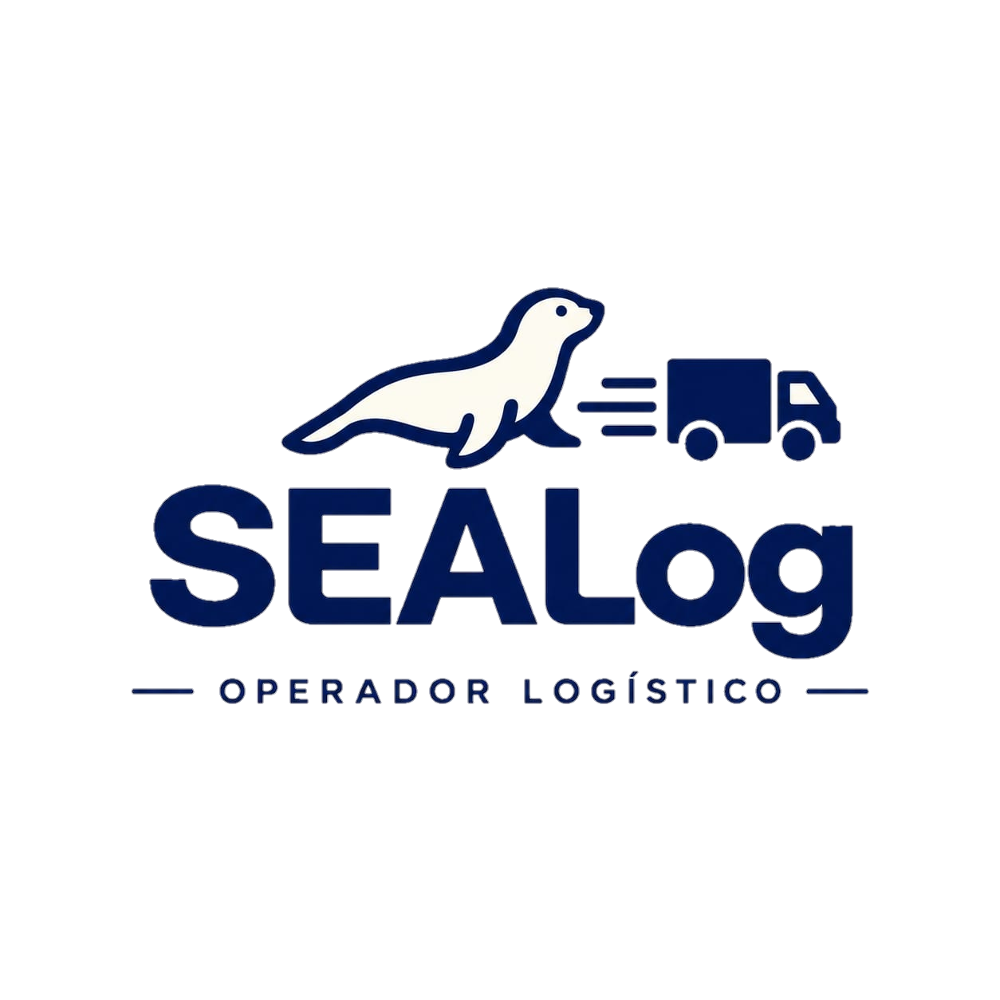

# SEALog

<p align="center">
  
</p>

<p align="center">
  Gestão de pedidos e entregas em uma única operação — do cadastro à confirmação de entrega.
</p>

---

## Sobre o projeto

O SEALog é uma aplicação web para organizar a operação de entregas: registra pedidos, acompanha o andamento de cada entrega, facilita a distribuição entre parceiras e reúne informações operacionais e financeiras.

A interface é responsiva e oferece diferentes áreas de trabalho conforme o perfil selecionado. O projeto inclui dados de demonstração para explorar os fluxos sem precisar configurar um serviço externo.

## O que dá para fazer

- Cadastrar pedidos com uma ou mais entregas e acompanhar dados pendentes.
- Consultar entregas, buscar registros e visualizar seu histórico de status.
- Distribuir entregas entre empresas parceiras por região.
- Registrar atualizações de entrega e ocorrências.
- Revisar decisões operacionais e consultar o painel do dia.
- Consultar informações financeiras e exportar dados em CSV.
- Acompanhar entregas pelo portal de demonstração do cliente.

### Perfis disponíveis

| Perfil | Área principal |
| --- | --- |
| Atendente | Cadastro e acompanhamento de pedidos |
| Analista | Painel e distribuição |
| Financeiro | Cobranças, repasses e fechamento |
| Operação | Coletas, rotas e atualização de entregas |
| Coordenação | Ocorrências e gestão de parceiras |
| Cliente | Acompanhamento das entregas do negócio selecionado |

Na tela inicial, escolha um dos perfis para entrar. Para testar o portal, selecione um negócio na lista de clientes de demonstração.

## Tecnologias

- React e TypeScript
- Vite
- React Router
- Zustand
- Tailwind CSS
- Playwright para testes end-to-end

## Comece a usar

**Pré-requisitos:** Node.js e npm.

```bash
# Instale as dependências
npm ci

# Inicie o servidor local
npm run dev
```

Abra no navegador o endereço mostrado pelo Vite (normalmente `http://localhost:5173`).

## Verificações

```bash
# Verifica os tipos e gera a versão de produção em dist/
npm run build

# Instala o navegador usado pelos testes (necessário na primeira execução)
npx playwright install chromium

# Executa os testes end-to-end em desktop e celular
npm run test:e2e
```

Os testes iniciam o servidor de desenvolvimento automaticamente. Para detalhes adicionais dos fluxos cobertos, consulte [docs/frontend.md](docs/frontend.md).

## Dados e ambiente

Este projeto é uma demonstração frontend: os dados e a sessão são armazenados no `localStorage` do navegador, e registros iniciais de demonstração são carregados na primeira execução. Limpar os dados do site no navegador remove as alterações locais.

O seletor de perfil serve para explorar as diferentes áreas da demonstração; ele não representa autenticação real. A aplicação não configura um backend nem sincroniza os dados entre navegadores.
